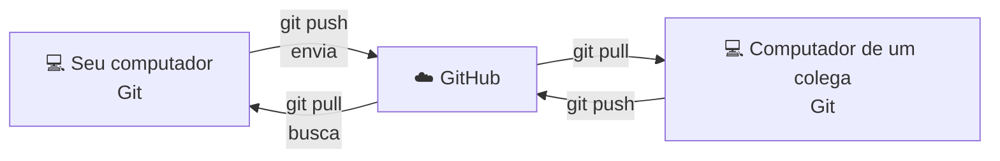
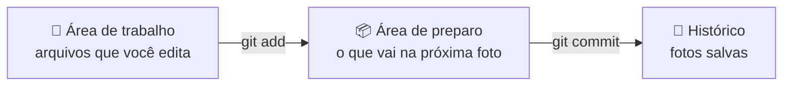

# 0. O que é Git e GitHub?

> ⏱️ 10 minutos · Nenhum comando ainda, só a ideia.

## O problema

Você já fez um trabalho da faculdade e salvou assim?

```
trabalho.docx
trabalho_final.docx
trabalho_final_AGORA_VAI.docx
trabalho_final_AGORA_VAI_v2_revisado_professor.docx
```

Agora imagine isso com **10 pessoas** mexendo nos **mesmos arquivos** de código ao mesmo tempo. É exatamente o problema que o Git resolve.

## O que é Git?

**Git é uma máquina do tempo para os seus arquivos.**

Cada vez que você chega num ponto importante, tira uma "foto" do projeto. Essa foto se chama **commit**. Depois, você pode:

- ver tudo o que mudou entre uma foto e outra;
- voltar para qualquer foto antiga;
- saber **quem** mudou **o quê** e **quando**.

O Git roda no **seu computador**. Funciona até sem internet.

## O que é GitHub?

**GitHub é a nuvem onde guardamos os projetos Git para trabalhar em equipe.**

Pense assim:

| | Analogia |
|---|---|
| **Git** | O caderno onde você anota tudo o que fez |
| **GitHub** | A biblioteca onde todo mundo guarda e compartilha os cadernos |

O GitHub também tem coisas que o Git não tem: perfis, Pull Requests, revisão de código, issues, automações e muito mais.

## Como os dois conversam



Cada pessoa trabalha na sua máquina e, quando termina algo, **envia** para o GitHub. Os outros **buscam** as novidades de lá.

## As 3 áreas do Git

Esta é a ideia mais importante da trilha toda. Vale a pena entender bem:



1. **Área de trabalho:** onde você edita os arquivos normalmente.
2. **Área de preparo** (*staging*): você escolhe **quais** mudanças vão entrar na próxima foto. É como separar as roupas antes de colocar na mala.
3. **Histórico:** as fotos (commits) que ficaram salvas para sempre.

## Por que isso importa para você?

Praticamente toda empresa de tecnologia usa Git. Saber usar bem é uma das habilidades mais pedidas para quem está começando, e uma das que mais aparecem no seu perfil do GitHub, que funciona como um portfólio.

## 🎥 Prefere vídeo?

- [Git e GitHub, parte 1](https://www.youtube.com/watch?v=DqTITcMq68k)
- [Git e GitHub, parte 2](https://www.youtube.com/watch?v=UBAX-13g8OM)

## ✅ Checkpoint

Responda com suas palavras:

1. Qual a diferença entre Git e GitHub?
2. O que é um commit?
3. Para que serve a área de preparo?

## 🧠 Desafio sem IA

Explique para alguém da sua família, sem usar nenhuma palavra técnica, o que é o Git. Se a pessoa entender, você entendeu.

---

[⬅️ Início](README.md) · [Próximo: Instalação no Windows ➡️](01-instalacao/windows.md) · [Instalação no Mac ➡️](01-instalacao/mac.md)
