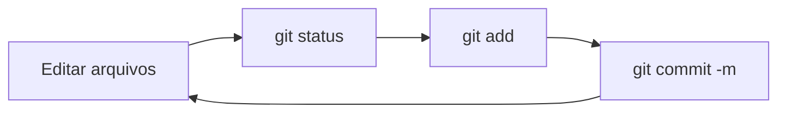

# 4. Primeiros comandos

> ⏱️ 20 minutos · Mão na massa! Faça junto, no seu computador.

Vamos criar um projeto de treino do zero. Nada aqui vai para o GitHub ainda, então pode errar à vontade.

## Navegando no terminal

Antes do Git, três comandos de terminal que você vai usar sempre:

| Comando | O que faz |
|---|---|
| `pwd` | Mostra em qual pasta você está |
| `ls` | Lista os arquivos da pasta |
| `cd nome-da-pasta` | Entra numa pasta (`cd ..` volta uma) |

## 1. Criar a pasta do projeto

```bash
mkdir treino-git
cd treino-git
```

## 2. `git init`: transformar a pasta num repositório

```bash
git init
```

```
Initialized empty Git repository in .../treino-git/.git/
```

O Git criou uma pasta escondida chamada **`.git`**. É lá que ele guarda todo o histórico. **Nunca mexa nela manualmente.**

## 3. `git status`: o comando mais importante

```bash
git status
```

Rode sempre que estiver em dúvida. Ele diz em que branch você está e o que mudou. Agora vai dizer que não há nada para commitar.

## 4. Criar um arquivo

Crie o arquivo `sobre-mim.md` com o VS Code (`code sobre-mim.md`) e escreva:

```markdown
# Sobre mim

Meu nome é ... e estou aprendendo Git!
```

Salve e rode:

```bash
git status
```

O arquivo aparece em **vermelho**, como `Untracked files`: o Git está vendo o arquivo, mas ainda não está acompanhando.

## 5. `git add`: colocar na área de preparo

```bash
git add sobre-mim.md
git status
```

Agora ele aparece em **verde**, como `Changes to be committed`. Lembra das [3 áreas](00-o-que-e-git-e-github.md#as-3-áreas-do-git)? O arquivo saiu da área de trabalho e foi para a área de preparo.

> 💡 `git add .` adiciona **todas** as mudanças da pasta. Prático, mas confira antes com `git status` para não incluir arquivos que não deveria.

## 6. `git commit`: tirar a foto

```bash
git commit -m "Adiciona arquivo sobre mim"
```

```
[main (root-commit) a1b2c3d] Adiciona arquivo sobre mim
 1 file changed, 3 insertions(+)
```

Pronto, seu primeiro commit! 🎉

### Escrevendo boas mensagens de commit

A mensagem explica **o que** a mudança faz. Escreva como se completasse a frase *"Este commit..."*:

| ✅ Bom | ❌ Ruim |
|---|---|
| `Adiciona página de contato` | `mudanças` |
| `Corrige cor do botão no modo escuro` | `arrumei` |
| `Remove arquivo de teste não usado` | `asdfgh` |

Muitos projetos usam um prefixo, o padrão **Conventional Commits**: `feat:` (novidade), `fix:` (correção), `docs:` (documentação), `chore:` (manutenção). Por exemplo: `feat: adiciona meu card no mural`.

## 7. Alterar e commitar de novo

Edite o `sobre-mim.md` e adicione uma linha. Depois:

```bash
git status
git diff
```

O **`git diff`** mostra exatamente o que mudou: linhas com `+` foram adicionadas, com `-` foram removidas. (Para sair da tela do diff, aperte `q`.)

```bash
git add sobre-mim.md
git commit -m "Adiciona meus hobbies"
```

## 8. `git log`: ver o histórico

```bash
git log
```

Mostra todos os commits, do mais novo para o mais antigo, com autor, data e mensagem. Aperte `q` para sair.

Versão resumida:

```bash
git log --oneline
```

Ou o atalho colorido que você configurou no [.gitconfig](03-configuracao/gitconfig.md):

```bash
git l
```

## 9. `.gitignore`: arquivos que o Git deve ignorar

Alguns arquivos **não devem** ir para o repositório: senhas, configurações locais, a pasta `node_modules`... Crie um arquivo chamado **`.gitignore`**:

```
# Dependências
node_modules/

# Variáveis de ambiente (podem ter senhas!)
.env

# Arquivos do sistema
.DS_Store
Thumbs.db
```

O que estiver listado ali, o Git finge que não existe.

## Resumo



| Comando | Para quê |
|---|---|
| `git init` | Criar um repositório |
| `git status` | Ver o que mudou |
| `git add arquivo` | Preparar para o commit |
| `git commit -m "msg"` | Salvar a foto |
| `git diff` | Ver as mudanças linha por linha |
| `git log` | Ver o histórico |

## ✅ Checkpoint

`git log --oneline` mostra pelo menos **2 commits** seus.

## 🧠 Desafio sem IA

1. Crie dois arquivos novos, `a.txt` e `b.txt`.
2. Faça um commit que contenha **só** o `a.txt`.
3. Confira com `git status` que o `b.txt` continua de fora.

---

[⬅️ SSH](03-configuracao/ssh.md) · [Próximo: Branches ➡️](05-branches.md)
