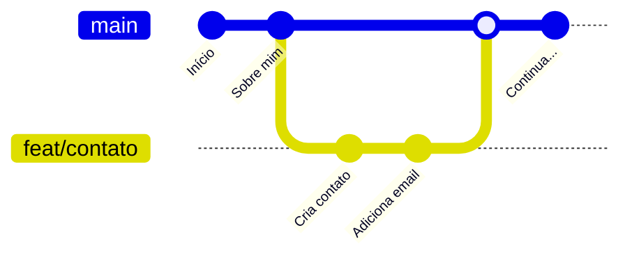

# 5. Branches: trabalhando em paralelo

> ⏱️ 15 minutos · Continue no projeto `treino-git`.

## O que é uma branch?

Uma **branch** (ramo) é uma linha do tempo paralela do projeto. Você cria uma branch para mexer em algo **sem afetar** a versão principal. Se der certo, junta. Se der errado, joga fora.



A branch principal se chama **`main`**. Nos projetos da comunidade, **ninguém commita direto na `main`**: todo trabalho acontece numa branch e entra por Pull Request.

## Ver as branches

```bash
git branch
```

A branch atual aparece com `*`.

## Criar uma branch e mudar para ela

```bash
git switch -c feat/contato
```

- `switch` = trocar de branch
- `-c` = criar antes de trocar

> 💡 Você vai ver em tutoriais antigos o `git checkout -b`. Faz a mesma coisa. O `git switch` é a forma mais nova e mais clara.

### Nomes de branch

Use um prefixo e uma descrição curta, com hífen:

- `feat/pagina-contato`: nova funcionalidade
- `fix/botao-quebrado`: correção
- `docs/atualiza-readme`: documentação
- `feat/card-seu-username`: seu card no mural 😉

## Trabalhar na branch

Crie o arquivo `contato.md`, adicione e commite:

```bash
git add contato.md
git commit -m "feat: cria página de contato"
```

Agora volte para a `main`:

```bash
git switch main
ls
```

O `contato.md` **sumiu**! Calma: ele está seguro na branch `feat/contato`. A `main` simplesmente ainda não tem ele.

## Juntar a branch na main: `git merge`

Estando na `main`:

```bash
git merge feat/contato
```

Agora a `main` tem o `contato.md`. 🎉

## Apagar a branch que já foi juntada

```bash
git branch -d feat/contato
```

O `-d` só apaga se a branch já foi juntada, então é seguro.

## Conflitos

Se duas branches mudarem **a mesma linha** do mesmo arquivo, o Git não sabe qual escolher e pede sua ajuda. Isso se chama **conflito**. Não é um erro, é só uma pergunta. Veja como resolver no [guia de problemas](08-quando-da-errado.md#conflito-de-merge).

> 🎥 Quer ver isso na prática? A [parte 2 do vídeo de Git e GitHub](https://www.youtube.com/watch?v=UBAX-13g8OM) complementa esta etapa e as próximas.

## ✅ Checkpoint

```bash
git l
```

O histórico mostra o commit da página de contato na `main`.

## 🧠 Desafio sem IA

1. Crie a branch `feat/hobbies` e mude a última linha do `sobre-mim.md`.
2. Volte para a `main` e mude **a mesma linha** de outro jeito, com outro commit.
3. Tente fazer o merge. Você criou seu primeiro conflito! Tente resolver sozinho antes de ler o guia.

---

[⬅️ Primeiros comandos](04-primeiros-comandos.md) · [Próximo: Repositórios remotos ➡️](06-remoto.md)
