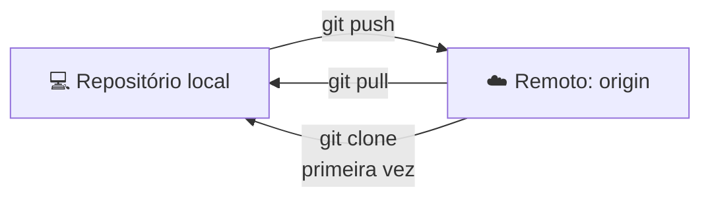

# 6. Repositórios remotos: falando com o GitHub

> ⏱️ 15 minutos

Até agora tudo ficou no seu computador. Um **remoto** é uma cópia do repositório em outro lugar, geralmente no GitHub.



## `git clone`: baixar um projeto

Copia um repositório do GitHub para o seu computador, **com todo o histórico**:

```bash
git clone https://github.com/Unidunedev/onboarding.git
cd onboarding
```

> Você encontra esse endereço no botão verde **`<> Code`** de qualquer repositório. Já configurou o [SSH](03-configuracao/ssh.md)? Use a aba **SSH**, com endereço `git@github.com:...`.

O Git já cria automaticamente um remoto chamado **`origin`**, apontando para onde você clonou:

```bash
git remote -v
```

## `git pull`: buscar novidades

Traz os commits novos do remoto e junta com os seus:

```bash
git pull
```

👉 **Hábito de ouro:** sempre rode `git pull` na `main` **antes** de criar uma branch nova. Assim você começa a partir da versão mais atual.

## `git push`: enviar seus commits

```bash
git push
```

> 🔐 No **primeiro push**, o Git abre o navegador (ou uma janelinha) para você entrar na sua conta do GitHub. Depois disso, o acesso fica salvo.

Na **primeira vez** que você envia uma branch nova, o Git precisa saber para onde mandar:

```bash
git push -u origin feat/minha-branch
```

O `-u` "liga" a sua branch local à do GitHub. Nas próximas vezes, basta `git push`.

## `git fetch`: olhar sem mexer

Baixa as novidades do remoto, mas **não mexe** nos seus arquivos. Útil para ver o que mudou antes de juntar:

```bash
git fetch
git log --oneline main..origin/main
```

Esse segundo comando lista os commits que estão no GitHub e ainda não estão na sua `main`.

> `git pull` = `git fetch` + `git merge`

## Subindo um projeto local para o GitHub

Quer colocar o seu `treino-git` no GitHub?

1. No GitHub, clique em **+ → New repository**, dê o nome `treino-git` e **não** marque nenhuma opção de README, `.gitignore` ou licença.
2. No terminal, dentro da pasta do projeto:

```bash
git remote add origin https://github.com/SEU-USERNAME/treino-git.git
git push -u origin main
```

Atualize a página do GitHub: seus commits estão lá! 🎉

## ✅ Checkpoint

- [ ] Clonei o repositório `onboarding`
- [ ] Subi o `treino-git` para o meu GitHub

## 🧠 Desafio sem IA

No GitHub, edite o `sobre-mim.md` do seu `treino-git` direto pelo navegador (ícone de lápis) e faça o commit por lá. Depois, traga essa mudança para o seu computador. Qual comando você usou?

---

[⬅️ Branches](05-branches.md) · [Próximo: Fork e Pull Request ➡️](07-fork-e-pull-request.md)
