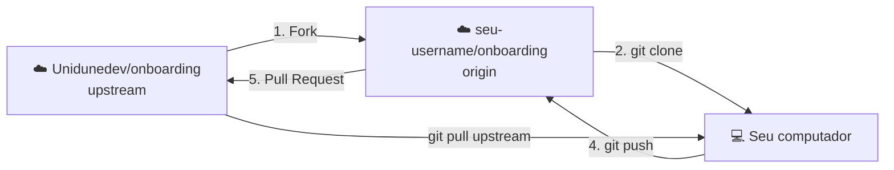

# 7. Fork e Pull Request: contribuindo com um projeto

> ⏱️ 20 minutos · Este é o **Desafio do 1º PR**!

Você não pode fazer `push` direto em projetos de outras pessoas. Então como contribuir? Com **fork** e **Pull Request**.

## Os conceitos

- **Fork:** uma cópia do projeto **na sua conta** do GitHub. Lá você pode fazer o que quiser.
- **Pull Request (PR):** um pedido para o projeto original "puxar" as suas mudanças. Alguém revisa, comenta e, se estiver tudo certo, aprova e faz o merge.
- **upstream:** o nome que damos ao repositório **original** (o da organização).
- **origin:** o **seu fork**.



## O fluxo completo

### 1. Fazer o fork

1. Acesse **https://github.com/Unidunedev/onboarding**.
2. Clique em **Fork** (canto superior direito) → **Create fork**.

Agora existe `github.com/SEU-USERNAME/onboarding`.

### 2. Clonar o **seu fork**

```bash
git clone git@github.com:SEU-USERNAME/onboarding.git
cd onboarding
```

### 3. Conectar ao projeto original

```bash
git remote add upstream git@github.com:Unidunedev/onboarding.git
git remote -v
```

Agora você tem dois remotos: `origin` (seu fork) e `upstream` (original).

### 4. Criar uma branch

```bash
git switch -c feat/card-SEU-USERNAME
```

### 5. Fazer a mudança

No Desafio do 1º PR, você cria o arquivo **`membros/SEU-USERNAME.json`** com o JSON que o [site de onboarding](https://onboarding.unidunedev.workers.dev) gerou para você.

> ⚠️ O nome do arquivo precisa ser **exatamente** o seu username do GitHub.

Quer conferir antes de enviar? Se tiver o Node.js instalado:

```bash
npm install
npm run validar-membros
```

### 6. Commitar e enviar para o **seu fork**

```bash
git add membros/SEU-USERNAME.json
git commit -m "feat: adiciona meu card no mural"
git push -u origin feat/card-SEU-USERNAME
```

### 7. Abrir o Pull Request

1. Acesse o seu fork no GitHub. Vai aparecer um aviso amarelo: **Compare & pull request**. Clique nele.
2. Confira: da sua branch (`SEU-USERNAME/onboarding` · `feat/card-...`) **para** `Unidunedev/onboarding` · `main`.
3. Preencha o título e o checklist do template.
4. Clique em **Create pull request**.

### 8. Acompanhar

- **Checks:** um robô (GitHub Actions) valida o seu JSON. ✅ verde, tudo certo. ❌ vermelho? Clique em **Details** para ver o que ajustar.
- **Prévia:** a Cloudflare comenta um link com a prévia do site já com o seu card.
- **Revisão:** alguém da liderança pode pedir ajustes nos comentários.

Precisa corrigir algo? É só editar, commitar e dar `git push` **na mesma branch**. O PR atualiza sozinho, não precisa abrir outro.

### 9. Merge! 🎉

Quando aprovarem e fizerem o merge, em poucos minutos o seu card aparece no [Mural da galera](https://onboarding.unidunedev.workers.dev/mural).

## Mantendo o seu fork atualizado

O projeto original continua recebendo mudanças. Antes de começar uma contribuição nova:

```bash
git switch main
git pull upstream main
git push origin main
```

> 💡 Também dá para usar o botão **Sync fork** na página do seu fork no GitHub e depois rodar `git pull` no seu computador.

## Sem terminal: fazendo tudo pelo navegador

Ainda não se sente à vontade com o terminal? O PR também pode ser feito 100% pelo GitHub:

1. No seu fork, entre na pasta `membros/`.
2. **Add file → Create new file**.
3. Nome: `SEU-USERNAME.json`. Cole o JSON.
4. **Commit changes** → marque **Create a new branch** → **Propose changes**.
5. **Create pull request**.

Vale como primeiro passo, mas depois tente o caminho pelo terminal. 😉

## ✅ Checkpoint

Seu PR está aberto em **https://github.com/Unidunedev/onboarding/pulls** com os checks verdes.

## 🧠 Desafio sem IA

Encontre o PR de um colega e deixe um comentário útil na aba **Files changed** (pode ser um elogio ou uma sugestão). Revisar o código dos outros também é trabalho de dev. 🛡️ Esse é o Nível 3: Guardião!

---

[⬅️ Repositórios remotos](06-remoto.md) · [Próximo: Quando dá errado ➡️](08-quando-da-errado.md)
