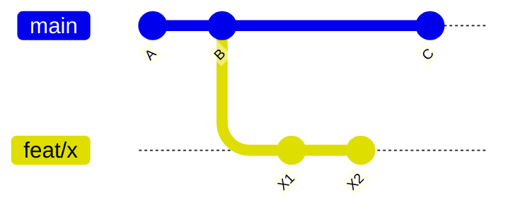

# 9. Avançado

> 📖 Para quando o básico já estiver confortável. Não precisa decorar: entenda a ideia e volte quando precisar.

## stash: guardar mudanças na gaveta

Está no meio de algo e precisa trocar de branch rapidinho? Guarde as mudanças sem commitar:

```bash
git stash              # guarda
git switch outra-branch
# ... resolve o que precisava ...
git switch -            # volta para a branch anterior
git stash pop          # devolve as mudanças
```

| Comando | Para quê |
|---|---|
| `git stash -u` | Guarda também arquivos novos (untracked) |
| `git stash list` | Lista o que está guardado |
| `git stash drop` | Joga fora o último guardado |

## Rebase

O `merge` junta duas branches criando um commit de junção. O **rebase** faz diferente: "replanta" os seus commits **em cima** da versão mais nova, como se você tivesse começado agora. O histórico fica uma linha reta.



Depois de `git rebase main` na branch `feat/x`, os commits `X1` e `X2` passam a vir **depois** de `C`.

Atualizando sua branch com a `main` mais nova:

```bash
git switch feat/minha-branch
git fetch upstream
git rebase upstream/main
```

Se der conflito: resolva, rode `git add arquivo` e depois `git rebase --continue`. Para desistir: `git rebase --abort`.

> ⚠️ **A regra de ouro do rebase:** nunca faça rebase de commits que **outras pessoas** já baixaram. Ele reescreve o histórico. Na sua própria branch de PR, tudo bem, mas depois do rebase o push precisa ser:
>
> ```bash
> git push --force-with-lease
> ```
>
> O `--force-with-lease` é a versão segura do `--force`: ele se recusa a sobrescrever se alguém tiver enviado algo novo nesse meio tempo.

### `pull.rebase`: merge ou rebase no pull?

No nosso [.gitconfig](03-configuracao/gitconfig.md) usamos `pull.rebase = false`, ou seja, o `git pull` faz **merge**. É o mais seguro para quem está começando. Muitos times usam `true` para manter o histórico linear. Agora você sabe a diferença.

## Rebase interativo: arrumando seus commits

Fez 5 commits tipo "teste", "agora vai", "corrige"? Antes de abrir o PR, dá para juntar tudo num commit só:

```bash
git rebase -i HEAD~5
```

Abre o editor com a lista dos commits. Troque `pick` por:

| Palavra | O que faz |
|---|---|
| `pick` | Mantém o commit |
| `reword` | Mantém, mas muda a mensagem |
| `squash` | Junta com o commit de cima |
| `fixup` | Junta com o de cima e descarta a mensagem |
| `drop` | Apaga o commit |

Salve e feche. Mesmas regras do rebase: só em commits que ainda não foram compartilhados (ou na sua branch de PR, com `--force-with-lease`).

## cherry-pick: trazer um commit específico

Precisa de **um** commit de outra branch, sem trazer o resto?

```bash
git cherry-pick a1b2c3d
```

## amend: ajustar o último commit

```bash
git commit --amend            # muda a mensagem e/ou inclui arquivos preparados
git commit --amend --no-edit  # inclui arquivos preparados mantendo a mensagem
```

É o que o alias `git amend` do nosso `.gitconfig` faz. Só antes do push (ou na sua branch de PR com `--force-with-lease`).

## reflog: a rede de segurança

O `git log` mostra a história do projeto. O **`git reflog`** mostra a **sua** história: cada commit, troca de branch, reset e rebase que você fez.

```bash
git reflog
```

```
a1b2c3d HEAD@{0}: reset: moving to HEAD~3
e4f5g6h HEAD@{1}: commit: Adiciona contato
...
```

Fez um `reset --hard` errado? Volte para o estado de antes:

```bash
git reset --hard HEAD@{1}
```

## Tags: marcando versões

```bash
git tag v1.0.0
git push origin v1.0.0
```

Usadas para marcar lançamentos (releases).

## blame e bisect: investigando

| Comando | Para quê |
|---|---|
| `git blame arquivo` | Mostra quem mudou cada linha e em qual commit |
| `git bisect` | Encontra, por busca binária, o commit que introduziu um bug |

No VS Code, a extensão **GitLens** mostra o `blame` direto no editor.

## 🧠 Desafio sem IA

No seu `treino-git`:

1. Faça 3 commits pequenos numa branch nova.
2. Use o rebase interativo para juntar os 3 em um só.
3. Use o `git reflog` para encontrar os 3 commits originais. Eles ainda existem?

---

[⬅️ Quando dá errado](08-quando-da-errado.md) · [Glossário 📖](glossario.md)
